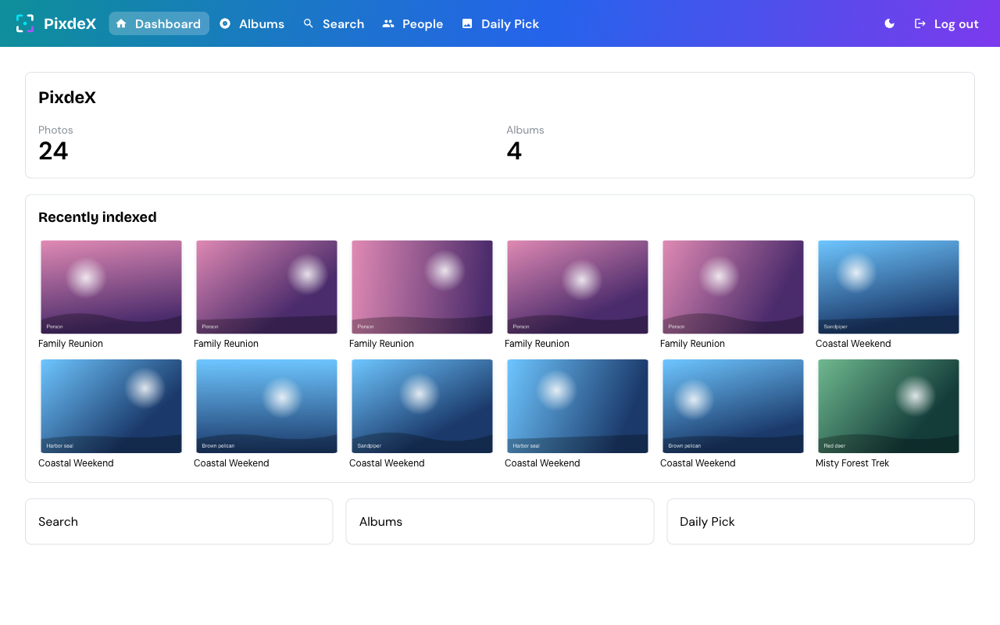
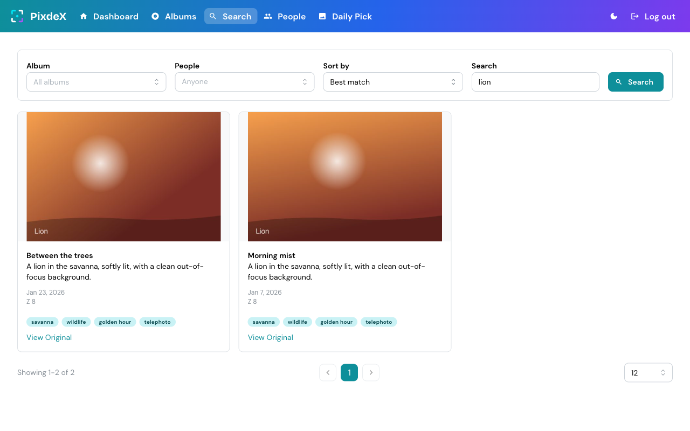
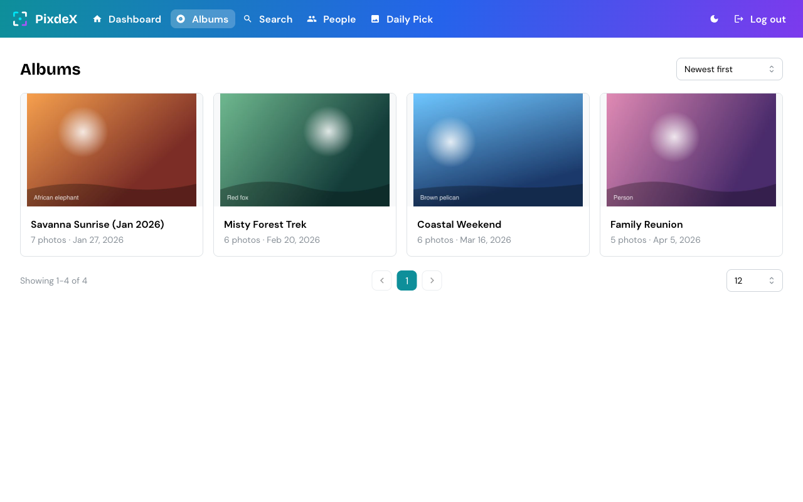
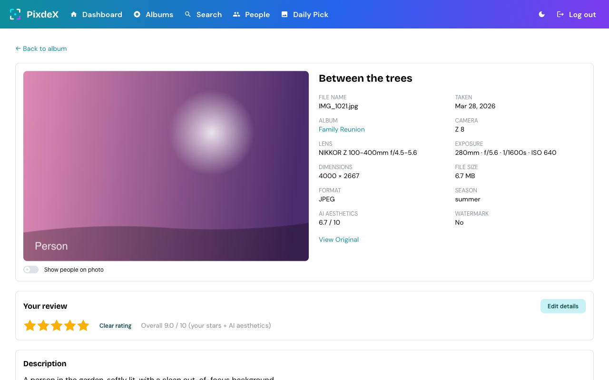
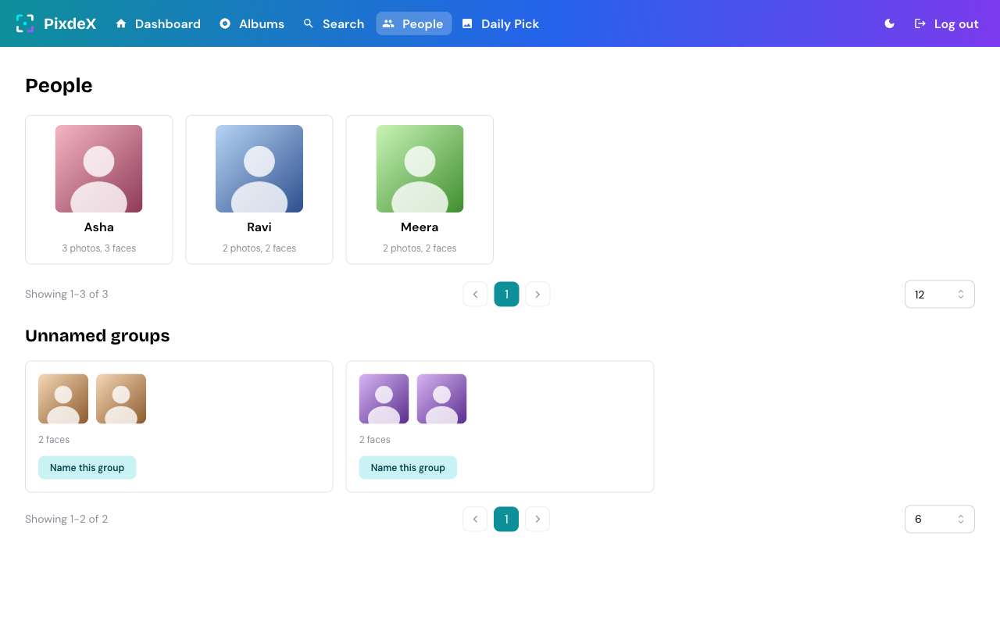

<h1 align="center">
  <picture>
    <source media="(prefers-color-scheme: dark)" srcset="docs/pixdex-logo.png">
    
  </picture>
</h1>

[](https://github.com/varunkumar/pixdex/commits/main)
[](https://github.com/varunkumar/pixdex/commits/main)

A private, searchable home for a personal photo library, built around wildlife and
nature photography. A local vision model (Ollama) describes, tags and rates every
photo, a local face model groups the people in them, and a small Cloudflare backend
lets you search it all from any browser. Only metadata and thumbnails leave your
machine. Originals stay on local disk or Google Drive.



*All screenshots in this README use generated placeholder images and made-up data.*

## What you can do

- **Search in plain words.** Full-text search across AI titles, descriptions,
  species, tags and environment, filtered by album and by up to 5 people.
- **Scroll a timeline.** A `/timeline` page groups photos by date, newest first.
  Zoom between Day (every photo), Month (highlights) and Year (a few per month)
  with the segmented control, Ctrl+wheel or a two-finger pinch; once you have
  scrolled past the newest month, zooming keeps the month you are reading. Highlights are
  photos whose combined score is at least 6.0, topped up to the best 3 per group;
  Year shows the top 6 per month. A year/month scrubber rail on the side jumps to
  any month with photos; while dragging it shows the month under the pointer,
  and on a long history it thins the year labels so they stay readable. Zoom, filters and jump position live in the URL.
- **Search by date.** Search has a date range picker, quick chips (Today, This
  week, This month, This year) and an "On this day" chip (same month and day in
  every year). Typed shortcuts work too: `lion june 2025`, `2025`, `jun 2025` or
  `2025-06-14` become a date range and are removed from the text query.
  Known limitation: dates are stored and grouped as UTC, not the local date
  taken. In IST, a photo taken between midnight and 05:29 shows under the
  previous day (and month or year at the boundary), and "Today" can miss this
  morning's early photos. See [Architecture](docs/architecture.md).
- **Search with one box.** The Search page is an omnibox: albums, people, known
  personalities and dates become removable chips. Type a name and, from 3 characters
  after a short pause (150 ms), matching names appear as suggestions
  (at most 3 per typed phrase, then "+N more"); typing alone never filters, a pick
  turns the words into a chip. When two typed names both match, an "Add both" chip
  shows the real photo count. Enter runs a plain search. In Chrome with the Prompt
  API, "Ask AI" (or Cmd/Ctrl+Enter) turns a sentence into keywords instead, and
  "Add keywords" lets you type keywords yourself without the model. See
  [AI Search](#ai-search).
- **Browse albums.** Cover photos, counts and average ratings, sorted by date,
  name, size or rating.
- **Get a daily pick.** One nature or wildlife photo a day (no people), chosen from
  your best-rated shots, never from the same album two days running.
- **Rate and correct the AI.** Add 1-5 stars and fix the title, species and tags.
  Your edits survive re-indexing.
- **Find people.** Faces are detected locally, grouped, and matched to the names
  you give them.
- **See the details.** Camera, lens, focal length, aperture, shutter, ISO and GPS
  when the file has them, plus "View Original" for the full-resolution file.

| Search | Albums |
|---|---|
|  |  |
| **Photo page** | **People** |
|  |  |

## Architecture

PixdeX is a React app backed by a Cloudflare Worker (D1 + R2). A local agent
indexes your photos with Ollama and InsightFace and pushes only metadata and
thumbnails to the Worker. Originals never leave your disk or Drive.

```
photos ─► agent (Ollama + InsightFace sidecar) ─► Worker (D1, R2) ◄─ Pages proxy ◄─ browser
```

| Piece | Where it runs | Job |
|---|---|---|
| `src/` + `functions/api/` | Cloudflare Pages | UI, plus a same-origin proxy that adds the read token |
| `worker/` | Cloudflare Workers | Ingest and read API, search, timeline, albums, daily pick, people |
| `agent/` | Your machine | Indexes photos, scans faces, serves originals |

This repository's frontend never holds a secret: the browser only calls same-origin
`/api/*`.

## How indexing works

Indexing runs on your machine through the agent CLI (`agent/`), never through the
web UI. For each photo the agent:

1. Hashes the file and skips it if that hash is already indexed.
2. Reads EXIF (camera, lens, exposure, GPS) and cuts a thumbnail with `sharp`.
3. Asks the **vision model** (Ollama) for a structured description: subjects,
   colors, patterns, tags, season, environment and watermark. It then asks for a
   1-10 aesthetic score with a 3-4 word title, and finally writes a caption and
   hashtags.
4. If the face sidecar is on, sends the image to it for face boxes and embeddings,
   and uploads a small padded crop of each face (not the photo).
5. Pushes metadata and thumbnails to the Worker's `/ingest/*` routes with
   `INGEST_TOKEN`.

### Models

| Job | Model | Runs on | Notes |
|---|---|---|---|
| Describe, tag, rate, caption | `qwen3.8:27b-mlx` | Ollama (`OLLAMA_BASE_URL`, default `http://localhost:11434`) | Set `OLLAMA_MODEL` in `agent/.env` (the built-in default is still `qwen3.5:27b-mlx`). The model name is stored on each photo. Changing the model does not re-index existing photos: they are skipped by content hash and keep their old data, so a library can mix models. |
| Face detection and embeddings | InsightFace `buffalo_l` | Local Python sidecar (CoreML, CPU fallback) | Optional. The weights are non-commercial, so personal use only. |

Setup: install [Ollama](https://ollama.com), `ollama pull qwen3.8:27b-mlx`, then
copy `agent/.env.example` to `agent/.env` and set `OLLAMA_MODEL=qwen3.8:27b-mlx`, `CLOUDFLARE_API_BASE_URL` and
`INGEST_TOKEN` (the same value as the Worker's secret).

### Face sidecar (optional)

Face scanning is a local Python service in `agent/sidecar/` (setup in its
README). Start it, set `FACE_SIDECAR_URL=http://127.0.0.1:8799` in `agent/.env`
(it must be a loopback address), and indexing detects faces after each photo. A
sidecar failure is logged and never fails the photo. Only the face crop leaves
your disk.

### Indexing commands

```bash
cd agent
npm run dev -- index-local "/path/to/folder"   # one local folder
npm run dev -- index-drive                      # pick a Google Drive folder (OAuth, read-only)
npm run dev -- index-drive --folder <id-or-url> # no prompts; repeat --folder for several
npm run dev -- index-batch /Volumes/T9/Photos   # many albums, resumable
npm run dev -- index-status                     # progress, ETA, pending and failed
```

`index-drive` picks photos with these rules, applied folder by folder: if a folder has a `Processed` subfolder (any case), only
that subfolder is used (the folder's own photos and its other subfolders are ignored); otherwise the folder's own photos count and
every subfolder is visited, where the rule applies again. Camera RAW files (CR2, NEF, ARW, DNG, RAF, ORF, RW2 and others, by
extension or Drive mime type) are always ignored. The album is the first folder under the one you picked, however deep the photo
is (`Arun Marriage / Marriage Photos / 001` is the album "Arun Marriage"), so generic folder names like "001" or "Upload" never
merge unrelated folders into one album; photos directly in the picked folder use its name. This differs from `index-local`, which
uses the photo's own folder. Folders that only hold application files are skipped by default: names matching `*.lrdata`
(Lightroom previews), `*.aep`, `Adobe After Effects Auto-Save`, `(Footage)`, `*_AME`, `allresources` and `*.collagefactoryfree`.
Add your own with `--exclude <name-or-glob>` (repeatable, case-insensitive, `*` is a wildcard, whole folder name, e.g.
`--exclude video --exclude "*backup"`); a `Processed` folder is never skipped. It also skips duplicate content within a run, and
includes shared drives and "shared with me" folders. In the folder search, each result shows its parent folder name and id so same-named folders
can be told apart (or paste the folder URL with `--folder`).

`index-drive --dry-run` (with or without `--folder`) prints a directory tree of what would happen and changes nothing: for every
folder visited, its photo count, size, how many are already indexed and how many exceed `DRIVE_STAGING_MAX_MB`, plus notes such as
`[only Processed is used, ignoring 40 photos and 2 other folders outside it]` and `[3 RAW ignored]`, then a total. It downloads
nothing and does not call Ollama or the face sidecar; the only Worker call is the read-only `check-hashes` (one request per 500
photos).

Listing is fast and overlaps with indexing: folders are listed six at a time with 1000 entries per request, and photos are
indexed as soon as their folder has been listed, so the first photo starts after one request, not after the whole tree. While the
tree is still being listed you see `Listing: N folders, M photos found so far`, then `Listing finished`. A folder that cannot be
listed (for example no permission) is reported as `Failed listing ...` and the rest carries on.

The rest of `index-drive`: Drive reports a SHA-256 for
every binary file, so photos that are already indexed are skipped from the listing alone, without being downloaded
(a re-run of a big folder costs one listing plus one `check-hashes` request per 500 photos). Transient Drive errors
(429, rate limits, 5xx, network resets) are retried with backoff. With `--folder` the exit code is 1 if any photo failed.
Local disk use is bounded: photos are downloaded one at a time to `<tmpdir>/pixdex-drive-staging` and deleted right after each
is processed (indexed, skipped or failed), so at most one photo is on disk. A photo larger than `DRIVE_STAGING_MAX_MB`
(default 1024, set in `agent/.env`) is refused before download, and downloads left by a killed run (older than an hour)
are removed at the start of the next one.
If Google rejects the stored login (revoked, or expired after 7 days while the OAuth app is in "testing" mode), the
agent deletes `agent/.google-token.json` and asks you to run the command again to sign in.

`index-batch` indexes every `<album>/Processed` folder under one or more roots
(and skips `Unprocessed`), one album at a time, and records progress in
`agent/.index-state/queue.json`. Stop it, reboot, or lose the disk at any point:
running it again picks up where it left off, because finished albums are not
revisited and photos already in the index are skipped by content hash.

- Album folders (a folder that itself contains `Processed`) and roots (a folder
  of albums) can be mixed. Re-running rediscovers: new albums are queued, and a
  finished album is queued again if its number of photos changed.
- `--priority=bandipur,nagarhole` runs matching albums first (regexes, comma
  separated; the default puts wildlife albums first). `--retry-failed` retries
  albums that finished with failed photos.
- It waits (and logs why) when Ollama or the Worker is unreachable or a disk is
  not mounted, instead of recording failures.
- To start it automatically at login and restart it after a crash, run
  `agent/scripts/install-launchd.sh <folders...>` once (`--uninstall` removes
  it). Logs go to `agent/.index-state/batch.log`.

### Moving an album

```bash
cd agent
npm run move-album -- /Volumes/T9/abc /Volumes/T9/xyz --dry-run   # preview, changes nothing
npm run move-album -- /Volumes/T9/abc /Volumes/T9/xyz             # move the folder and update the index
npm run move-album -- /Volumes/T9/abc /Volumes/T9/xyz --index-only # you already moved it by hand
```

Standalone script (`agent/src/moveAlbumCli.ts`). It moves the folder (a rename on
the same volume; across volumes it copies, checks every file's size, then
deletes the source) and re-points the indexed photos' `path` through
`POST /ingest/relocate`, so thumbnails, captions, owner edits and faces stay
attached and nothing is re-indexed. The album name stays as it was indexed, even
if the new folder has a different name. It refuses to run if the destination
exists. If the index update fails after the move, re-run with `--index-only`.
`index-batch` keeps its own queue in `agent/.index-state/queue.json`; a moved
album shows up there as a new path on the next run.

## Prerequisites

- Node.js 18+
- A deployed instance of the `worker/` (see `worker/package.json` for its own
  scripts)
- For indexing: Ollama with the model above, and optionally Python 3.11 or 3.12 for
  the face sidecar

## Setup (frontend)

1. Install dependencies:

   ```bash
   npm install
   ```

2. Configure environment variables:

   Copy `.env.example` to `.env` and set `WORKER_URL` to your deployed
   worker's URL, and `READ_TOKEN` to the same value as the worker's
   `READ_TOKEN` secret. These are **not** `VITE_`-prefixed on purpose: they are
   used only by the dev server's `/api` proxy (`vite.config.ts`) and, in
   production, by the Pages Function in `functions/api/` (set `READ_TOKEN` and
   `WORKER_URL` as Pages secrets). The browser only ever talks to same-origin
   `/api/*`, so the read token never ships in the bundle:

   ```
   WORKER_URL=https://pixdex-worker.<your-subdomain>.workers.dev
   READ_TOKEN=<same value as the worker's READ_TOKEN secret>
   ```

3. Start the development server:

   ```bash
   npm run dev
   ```

## Scripts

| Where | Command | What it does |
|---|---|---|
| root | `npm run dev` | Vite dev server with the `/api` proxy |
| root | `PIXDEX_MOCK=1 npm run dev` | Dev server with dummy data (no secrets, no Worker; for checking the UI) |
| root | `npm run build` | Typecheck and build the frontend to `dist` |
| root | `npm test` | Frontend tests (Vitest) |
| root | `npm run lint` | ESLint |
| `worker/` | `npm test`, `npm run typecheck` | Worker tests and typecheck |
| `agent/` | `npm test`, `npm run typecheck` | Agent tests and typecheck |
| `agent/` | `npm run dev -- index-local <folder>` | Index one local folder |
| `agent/` | `npm run dev -- index-drive` | Index a Google Drive folder |
| `agent/` | `npm run dev -- index-batch <roots...>` | Resumable multi-album indexing |
| `agent/` | `npm run dev -- index-status [--json]` | Batch progress and ETA |
| `agent/` | `npm run dev -- serve-originals` | Serve full-resolution originals for the tunnel |
| `agent/scripts/` | `install-launchd.sh <folders...>` | Run `index-batch` at login (macOS) |
| `agent/sidecar/` | `python3 agent/sidecar/server.py` | Start the face sidecar |

## Rating and correcting the AI

On a photo's page, "Your review" lets you give 1-5 stars and edit the AI's
title, subjects (species) and tags. Edits live in separate columns, so
re-indexing never overwrites them, and search is re-indexed from your text (a
corrected species stops matching the model's wrong one). "Reset to AI" undoes
them. Your stars are blended with the model's aesthetic score (70% yours, 30%
the model's, on a 1-10 scale; the model's alone when you have not rated). That
combined score drives "Best rated" on the search and album pages, album average
ratings and the daily pick. The search page has a "Sort by" control (best match
by default) and a "People" filter (up to 5 values in total; photos containing all
selected people). The same box on Search and Timeline lists "Your people" (blue) and "Known personalities in
your photos" (violet, with a "known" marker); both are always shown, even for the same real person.
Typing only narrows the list, from 3 characters (matches anywhere inside a word, so "man" finds "Rahman" while "m" shows nothing; case and accents ignored; aliases included); picking an option filters. The description and suggested caption are not editable.

### Sharing albums

Every album has one owner: the `OWNER_EMAIL` in `agent/.env` when the agent indexes it (the first photo of an album
stamps its owner; indexing into an album owned by someone else is refused). An album's owner sees a Share button on the
album card and album page. It opens a dialog listing the owner and the people with access (each with an avatar) and lets you
add or remove Google sign-in emails (each address must match the person's Google sign-in email). The header shows your own
avatar and email (initials on a colour derived from the email, drawn locally, no third-party avatar service); album cards
show the sharees as an avatar stack. People you share with see the album with the owner's avatar and "Shared by <owner>" and cannot
rate, edit, set covers, share or name faces in it. People are per owner: you manage the people you created, and others'
people appear read-only where their faces are in photos you can see. Those controls are hidden in the UI and refused by the
Worker. A person's name belongs to its owner and is never sent to anyone else: you see "Unnamed person" until you give them your
own private name ("Add my name" on the People page, the person's page or a photo's People card; clearing the text removes it).
Only you see your name, and it changes nothing for the owner. Photos indexed with no album (files at the root of a drive) are visible to nobody, so keep every photo in a folder.

Setup (the Pages Function does the identity check, so Cloudflare Access must sit in front of the Pages site):

1. Set `ACCESS_TEAM_DOMAIN` and `ACCESS_AUD` as Pages variables, and `OWNER_EMAIL` in `agent/.env` (the Worker and Pages
   no longer read it; delete the old Worker secret if you set one). See `.env.example` and the rollout order in
   `docs/development.md`.
2. Deploy the Function and Worker, then run `cd worker && npm run backfill-owner` once. It stamps `OWNER_EMAIL` (from the
   environment or `agent/.env`) on every existing album and person (`--dry-run` prints the SQL, `--local` targets the local
   D1). Until it runs nothing is visible to you. Then change the Access policy from "only me" to allow any Google account.
3. Share an album from its card or page by entering the person's Google sign-in email. Removing the email revokes
   access, though images already cached in their browser may stay visible for a while.

For local development, set `DEV_VIEWER_EMAIL` in `.env` to preview the app as a person an album is shared with.

## People

The People page (`/people`) lists named people and groups of similar unnamed
faces. Name a group or add it to an existing person, and the app then looks for
that person's other faces; once someone is named, new faces are matched to them
automatically at ingest. The "People" card on each photo's page names or corrects
its faces, and "Show people on photo" draws numbered boxes over the photo.
People are listed alphabetically everywhere (the page, the Search filter, the
naming picker). A person's page sorts their photos by newest first (default),
best rated or alphabetical.

- Lower-confidence matches (score 0.4 to 0.5) land in a "Review suggestions" queue
  on the person's page. "Not X" on a face rejects that match permanently. "Remove
  name" (confirmed faces only) just unassigns the face.
- A person's cover defaults to their biggest confirmed face. Pick another with
  "Set as cover"; if that face is later removed, the cover falls back to the default.
- Grouping and matching ignore faces under a detection score of 0.7 or a side
  under 5% of the photo.
- The browser writes involved are `PATCH`/`DELETE people/:id`, `PUT`/`DELETE people/:id/label` (a viewer's own private name) and `POST` to
  `people`, `people/:id/faces`, `people/:id/match`, `people/:id/cover` and
  `faces/:id/assign|reject|unassign`, all through the Pages proxy.

### Known people list (agent)

`agent/known/people.json` is a curated list of public figures (405 entries, India first) that
`build-known-gallery` turns into reference faces from openly licensed Commons photos. Manage it
from `agent/` with `known-search "<name>"`, `known-add --id <Q...> [--name <n>] [--alias <a>]...`
and `known-check [--offline]` (exits 1 on issues). The full process is in `agent/known/README.md`.

When `agent/.index-state/known-gallery.json` exists, `index-local`, `index-drive`, `index-batch` and `backfill-faces` match each detected face against it and send the match with the face; without the file nothing changes. Matches are suggestions ("looks like"), never a claim of identity, and never name or assign a face.

Commands (from `agent/`): `known-search`, `known-add`, `known-check [--offline]`, `build-known-gallery [--rebuild <id>...] [--retry-excluded] [--full]`
(incremental; writes `agent/.index-state/known-gallery.json`, never committed; people with too few photos are remembered and skipped
unless `--rebuild <id>` or `--retry-excluded`; `--full` starts over) and `backfill-known [--dry-run] [--rescore] [--page-size <n>]` (matches
already indexed faces from their stored embeddings; `--rescore` after a threshold change, a removed person or a `--rebuild`). A rescan on a
machine without the gallery file resets known matches on rescanned faces; run `backfill-known` to restore them. Thresholds `KNOWN_THRESHOLD` 0.6 (raised from 0.5 after a dry-run on a family library matched only children at 0.50 to 0.54) and `KNOWN_MARGIN` 0.05 in
`agent/src/known/matcher.ts` are initial guesses to tune from the `--dry-run` output. Group photos (2 to 12 faces) also contribute: the face that clearly matches the person's single-face references is picked (see `agent/known/README.md`). People with fewer than 3 usable photos are left
out of the gallery, so fewer than the 405 listed will be recognized (the first build reports how many). Set the optional `WIKIMEDIA_CONTACT` (an email or project URL) in `agent/.env` to be identified to Wikimedia: 200 instead of 10 API requests per minute ([rate limits](https://www.mediawiki.org/wiki/Wikimedia_APIs/Rate_limits)); it is only sent in the User-Agent, never logged or committed. The build is slow by design (polite pacing, `Retry-After` honoured); if Wikimedia keeps rate limiting, it saves progress and stops, and rerunning is safe (see `agent/known/README.md`).

`known-pick [--id <Q-id>...] [--port <n>]` is a manual picker for people left excluded: it serves a local page (127.0.0.1 only, random per-run token in the printed URL) where you click the right face in each candidate photo; saved people become trusted references (no outlier filter, red warning below cosine 0.3), the gallery file is written atomically, and on exit a changed gallery is pushed to R2. Candidates (images, boxes, embeddings) are cached in `agent/.index-state/known-pick-cache/` so a restart does not re-crawl; see `agent/known/README.md`.

Backup: the gallery is built from public openly licensed photos and is also kept as one object (`known/gallery.json`) in your private R2 bucket, so a new machine does not repeat the multi-hour Wikimedia crawl. Only the agent can read or write it (ingest token); the Worker never parses it. `build-known-gallery` (unless `--full`) uses the local file, else restores the R2 copy, builds incrementally, and pushes the result when it changed or when R2 has no backup yet (checked with one R2 head; a failed push or check only warns, so your existing local gallery is backed up by the next build with no extra step). `known-gallery-push` and `known-gallery-pull [--force]` do it explicitly; pull will not overwrite an existing local file without `--force`. `backfill-known` also restores from R2 if the local file is missing. Scan commands stay local-only, so on a new machine run `known-gallery-pull` (or `build-known-gallery`) once before indexing. Cost: one R2 put per changed build (about 11 MB), one get per restore, one head per unchanged build, no D1, no Worker JSON work.

Rollout: merging applies migration `0018` before the Worker deploys. Then on your machine: `known-check`, `build-known-gallery`,
`backfill-known --dry-run`, tune the thresholds, `backfill-known`. Backfill is estimated at 1 to 3 minutes for about 5K photos
(not yet measured). See `docs/development.md` for the steps and how to measure.

## AI Search

AI Search is part of the Search page (there is no separate nav entry). In Chrome with
the Prompt API, "Ask AI" (or Cmd/Ctrl+Enter) turns a phrase such as "photos for a
Diwali greeting" into keywords with Chrome's built-in Prompt API (Gemini Nano), then
runs one normal search per keyword and ranks the photos. Photos matching rarer
keywords count for more. The keywords show as editable chips and the result list
shows which ones each photo matched. "Add keywords" (next to "Ask AI") skips the model:
type keywords such as "diya, rangoli" and press Enter. In AI mode the button below the box
is "Search again": it adds any keyword you typed and re-runs the keywords without the
model (Enter in the main box still runs a plain search). Album, people, known and date chips narrow
every keyword search (and the library total used for rarity), so "sunset" with an
album chip ranks only inside that album. State lives in the URL: `mode=ai`, `q`
(the sentence), `kw` (the keywords), and, when switched off, `hidePeople=0` and
`room=0`:

- **Hide people photos**, judged from each photo's stored subjects and tags
  (not face data). The switch is hidden while a person or known chip is active
  (filtering by a person and hiding people photos contradict each other).
- **Leave room for text**, which favours photos with calm, empty areas where a
  caption could go, measured in the browser from the thumbnail.

Old `/ai-search` links keep working: they redirect to `/search?mode=ai...` and the old
`people=0` becomes `hidePeople=0` (`q`, `kw`, `room` carry over). In browsers without
the Prompt API the redirect lands on a plain search and "Ask AI" is absent. To enable
it, use a recent desktop Chrome, turn on the Prompt API for Gemini Nano in
`chrome://flags` (for example `#prompt-api-for-gemini-nano`; flag names change between
Chrome builds), and install the model from `chrome://on-device-internals`. Everything
runs in the browser: the phrase and the images never leave your device, and the only
requests made are existing read routes through the same-origin proxy: `GET /api/search`
(one per keyword, the "Add both" count with `limit=1`), plus thumbnail reads. No
Worker, database, agent or Pages Function changes are involved; cost notes are in
`docs/development.md`.

## Originals (optional)

Search results and the daily pick show thumbnails only by default. To enable
"View Original" (local-disk and Google Drive photos alike: the agent streams
Drive files with its own stored Google token, so serve-originals needs a prior
`index-drive` sign-in; the photo page also has an "Open in Google Drive" link
for the album owner), follow `agent/cloudflared/README.md` once. The
browser never sees the tunnel URL or its token: links go to the same-origin
`/api/originals/:id` proxy, which needs `ORIGINALS_BASE_URL` and
`ORIGINALS_TOKEN` set as Pages secrets (and in `.env` for local dev).

## Tests and deploys

There is no GitHub Actions pipeline. `.githooks/pre-commit` (enabled by
`npm install`) runs the lint/test/build suites touched by the staged changes.
Cloudflare builds and deploys both the frontend (with `functions/`) and the
Worker from `main` via its GitHub integration (Pages for the frontend, Workers
Builds for `worker/`). Frontend build command is
`npm run build`, output `dist`. The Worker's deploy command also applies pending D1
migrations (`npx wrangler d1 migrations apply DB --remote && npx wrangler deploy`), so
a merged migration runs on production before the new code goes live. See
`docs/development.md` for deploy notes.

## Project Structure

- `src/components` - React UI (Timeline, Search, Albums, AlbumPhotos, PhotoDetail,
  DailySuggestion, Dashboard, Lightbox, Layout, People, AiResults), `src/components/omnibox`
  (the Search bar and suggestion panel) and `src/services/omnibox` (matcher, URL state)
- `src/services/aiSearch` - AI Search keyword expansion, ranking and empty-space scoring
- `dev/mockApi.ts` - dev-only dummy API (`PIXDEX_MOCK=1 npm run dev`)
- `src/hooks`, `src/services`, `src/types` - list/sort URL state, `WorkerApiClient`
  and helpers, API types
- `functions/api` - Pages Function: same-origin proxy that adds the read token
  (read routes plus the album cover, album shares, photo review and people/face writes); `functions/_lib`
  verifies the Cloudflare Access JWT
- `worker/` - Cloudflare Worker (Hono, D1, R2) and its migrations
- `agent/` - local indexing CLI and originals server; `agent/sidecar/` is the
  InsightFace service
- `docs/` - [architecture](docs/architecture.md),
  [development guide](docs/development.md), plans and specs, and
  `screenshots/` (README images, generated from dummy data)

Agent-oriented summary: `AGENTS.md`. Update this README and `AGENTS.md` with
every feature or change.

## Contributing

1. Fork the repository
2. Create your feature branch
3. Submit a pull request

## License

MIT. The InsightFace `buffalo_l` weights used by the optional face sidecar are
non-commercial, personal use only.
