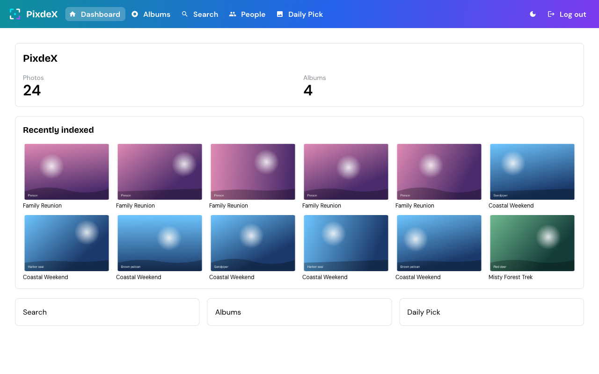
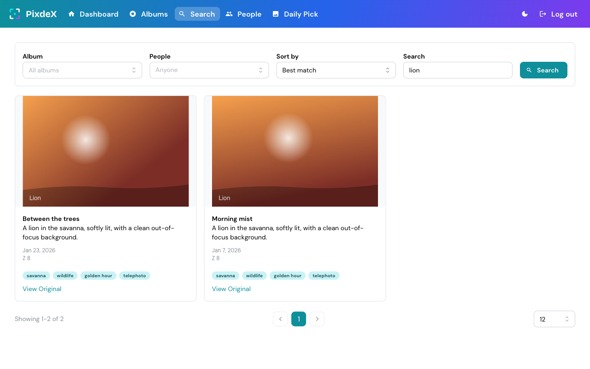
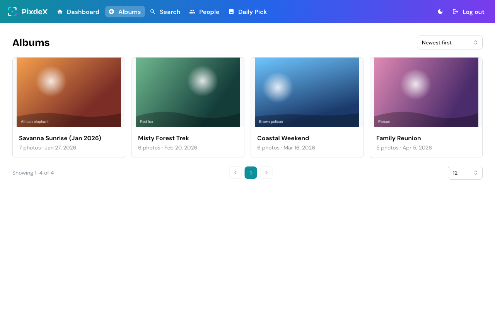
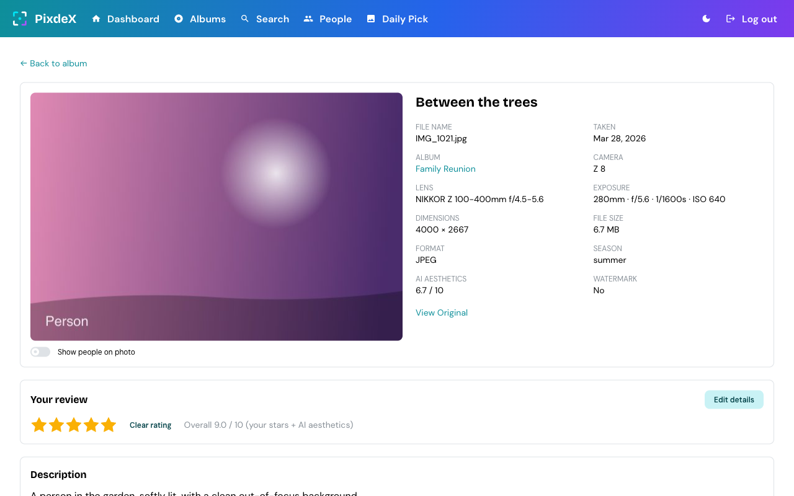
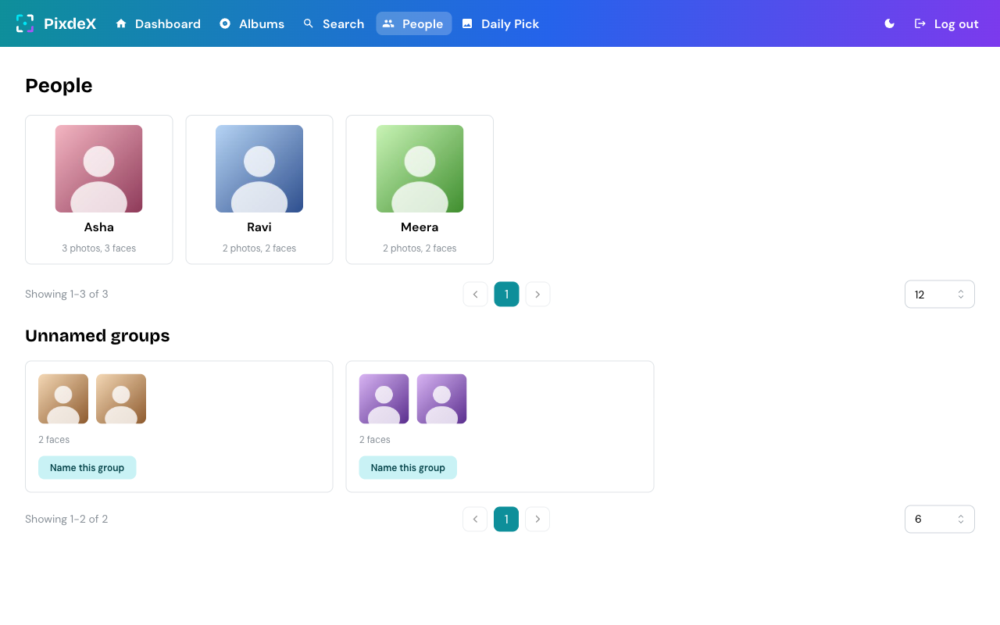

<h1 align="center">
  
</h1>

[](https://github.com/varunkumar/pixdex/commits/main)
[](https://github.com/varunkumar/pixdex/commits/main)

A private, searchable home for a personal photo library, built around wildlife and
nature photography. A local vision model (Ollama) describes, tags and rates every
photo, a local face model groups the people in them, and a small Cloudflare backend
lets you search it all from any browser. Only metadata and thumbnails leave your
machine. Originals stay on local disk or Google Drive.



*All screenshots in this README use generated placeholder images and made-up data.*

## What you can do

- **Search in plain words.** Full-text search across AI titles, descriptions,
  species, tags and environment, filtered by album and by up to 5 people.
- **Browse albums.** Cover photos, counts and average ratings, sorted by date,
  name, size or rating.
- **Get a daily pick.** One nature or wildlife photo a day (no people), chosen from
  your best-rated shots.
- **Rate and correct the AI.** Add 1-5 stars and fix the title, species and tags.
  Your edits survive re-indexing.
- **Find people.** Faces are detected locally, grouped, and matched to the names
  you give them.
- **See the details.** Camera, lens, focal length, aperture, shutter, ISO and GPS
  when the file has them, plus "View Original" for the full-resolution file.

| Search | Albums |
|---|---|
|  |  |
| **Photo page** | **People** |
|  |  |

## Architecture

PixdeX is a React app backed by a Cloudflare Worker (D1 + R2). A local agent
indexes your photos with Ollama and InsightFace and pushes only metadata and
thumbnails to the Worker. Originals never leave your disk or Drive.

```
photos ─► agent (Ollama + InsightFace sidecar) ─► Worker (D1, R2) ◄─ Pages proxy ◄─ browser
```

| Piece | Where it runs | Job |
|---|---|---|
| `src/` + `functions/api/` | Cloudflare Pages | UI, plus a same-origin proxy that adds the read token |
| `worker/` | Cloudflare Workers | Ingest and read API, search, albums, daily pick, people |
| `agent/` | Your machine | Indexes photos, scans faces, serves originals |

This repository's frontend never holds a secret: the browser only calls same-origin
`/api/*`.

## How indexing works

Indexing runs on your machine through the agent CLI (`agent/`), never through the
web UI. For each photo the agent:

1. Hashes the file and skips it if that hash is already indexed.
2. Reads EXIF (camera, lens, exposure, GPS) and cuts a thumbnail with `sharp`.
3. Asks the **vision model** (Ollama) for a structured description: subjects,
   colors, patterns, tags, season, environment and watermark. It then asks for a
   1-10 aesthetic score with a 3-4 word title, and finally writes a caption and
   hashtags.
4. If the face sidecar is on, sends the image to it for face boxes and embeddings,
   and uploads a small padded crop of each face (not the photo).
5. Pushes metadata and thumbnails to the Worker's `/ingest/*` routes with
   `INGEST_TOKEN`.

### Models

| Job | Model | Runs on | Notes |
|---|---|---|---|
| Describe, tag, rate, caption | `qwen3.5:27b-mlx` | Ollama (`OLLAMA_BASE_URL`, default `http://localhost:11434`) | Default `OLLAMA_MODEL`, override in `agent/.env`. The model name is stored on each photo. |
| Face detection and embeddings | InsightFace `buffalo_l` | Local Python sidecar (CoreML, CPU fallback) | Optional. The weights are non-commercial, so personal use only. |

Setup: install [Ollama](https://ollama.com), `ollama pull qwen3.5:27b-mlx`, then
copy `agent/.env.example` to `agent/.env` and set `CLOUDFLARE_API_BASE_URL` and
`INGEST_TOKEN` (the same value as the Worker's secret).

### Face sidecar (optional)

Face scanning is a local Python service in `agent/sidecar/` (setup in its
README). Start it, set `FACE_SIDECAR_URL=http://127.0.0.1:8799` in `agent/.env`
(it must be a loopback address), and indexing detects faces after each photo. A
sidecar failure is logged and never fails the photo. Only the face crop leaves
your disk.

### Indexing commands

```bash
cd agent
npm run dev -- index-local "/path/to/folder"   # one local folder
npm run dev -- index-drive                      # pick a Google Drive folder (OAuth, read-only)
npm run dev -- index-batch /Volumes/T9/Photos   # many albums, resumable
npm run dev -- index-status                     # progress, ETA, pending and failed
```

`index-batch` indexes every `<album>/Processed` folder under one or more roots
(and skips `Unprocessed`), one album at a time, and records progress in
`agent/.index-state/queue.json`. Stop it, reboot, or lose the disk at any point:
running it again picks up where it left off, because finished albums are not
revisited and photos already in the index are skipped by content hash.

- Album folders (a folder that itself contains `Processed`) and roots (a folder
  of albums) can be mixed. Re-running rediscovers: new albums are queued, and a
  finished album is queued again if its number of photos changed.
- `--priority=bandipur,nagarhole` runs matching albums first (regexes, comma
  separated; the default puts wildlife albums first). `--retry-failed` retries
  albums that finished with failed photos.
- It waits (and logs why) when Ollama or the Worker is unreachable or a disk is
  not mounted, instead of recording failures.
- To start it automatically at login and restart it after a crash, run
  `agent/scripts/install-launchd.sh <folders...>` once (`--uninstall` removes
  it). Logs go to `agent/.index-state/batch.log`.

## Prerequisites

- Node.js 18+
- A deployed instance of the `worker/` (see `worker/package.json` for its own
  scripts)
- For indexing: Ollama with the model above, and optionally Python 3.11 or 3.12 for
  the face sidecar

## Setup (frontend)

1. Install dependencies:

   ```bash
   npm install
   ```

2. Configure environment variables:

   Copy `.env.example` to `.env` and set `WORKER_URL` to your deployed
   worker's URL, and `READ_TOKEN` to the same value as the worker's
   `READ_TOKEN` secret. These are **not** `VITE_`-prefixed on purpose: they are
   used only by the dev server's `/api` proxy (`vite.config.ts`) and, in
   production, by the Pages Function in `functions/api/` (set `READ_TOKEN` and
   `WORKER_URL` as Pages secrets). The browser only ever talks to same-origin
   `/api/*`, so the read token never ships in the bundle:

   ```
   WORKER_URL=https://pixdex-worker.<your-subdomain>.workers.dev
   READ_TOKEN=<same value as the worker's READ_TOKEN secret>
   ```

3. Start the development server:

   ```bash
   npm run dev
   ```

## Scripts

| Where | Command | What it does |
|---|---|---|
| root | `npm run dev` | Vite dev server with the `/api` proxy |
| root | `npm run build` | Typecheck and build the frontend to `dist` |
| root | `npm test` | Frontend tests (Vitest) |
| root | `npm run lint` | ESLint |
| `worker/` | `npm test`, `npm run typecheck` | Worker tests and typecheck |
| `agent/` | `npm test`, `npm run typecheck` | Agent tests and typecheck |
| `agent/` | `npm run dev -- index-local <folder>` | Index one local folder |
| `agent/` | `npm run dev -- index-drive` | Index a Google Drive folder |
| `agent/` | `npm run dev -- index-batch <roots...>` | Resumable multi-album indexing |
| `agent/` | `npm run dev -- index-status [--json]` | Batch progress and ETA |
| `agent/` | `npm run dev -- serve-originals` | Serve full-resolution originals for the tunnel |
| `agent/scripts/` | `install-launchd.sh <folders...>` | Run `index-batch` at login (macOS) |
| `agent/sidecar/` | `python3 agent/sidecar/server.py` | Start the face sidecar |

## Rating and correcting the AI

On a photo's page, "Your review" lets you give 1-5 stars and edit the AI's
title, subjects (species) and tags. Edits live in separate columns, so
re-indexing never overwrites them, and search is re-indexed from your text (a
corrected species stops matching the model's wrong one). "Reset to AI" undoes
them. Your stars are blended with the model's aesthetic score (70% yours, 30%
the model's, on a 1-10 scale; the model's alone when you have not rated). That
combined score drives "Best rated" on the search and album pages, album average
ratings and the daily pick. The search page has a "Sort by" control (best match
by default) and a "People" filter (up to 5 named people; photos containing all
selected people). The description and suggested caption are not editable.

## People

The People page (`/people`) lists named people and groups of similar unnamed
faces. Name a group or add it to an existing person, and the app then looks for
that person's other faces; once someone is named, new faces are matched to them
automatically at ingest. The "People" card on each photo's page names or corrects
its faces, and "Show people on photo" draws numbered boxes over the photo.

- Lower-confidence matches (score 0.4 to 0.5) land in a "Review suggestions" queue
  on the person's page. "Not X" on a face rejects that match permanently. "Remove
  name" (confirmed faces only) just unassigns the face.
- A person's cover defaults to their biggest confirmed face. Pick another with
  "Set as cover"; if that face is later removed, the cover falls back to the default.
- Grouping and matching ignore faces under a detection score of 0.7 or a side
  under 5% of the photo.
- The browser writes involved are `PATCH`/`DELETE people/:id` and `POST` to
  `people`, `people/:id/faces`, `people/:id/match`, `people/:id/cover` and
  `faces/:id/assign|reject|unassign`, all through the Pages proxy.

## Originals (optional)

Search results and the daily pick show thumbnails only by default. To enable
"View Original" for local-disk photos (Drive-sourced photos always deep-link
to Drive, no setup needed), follow `agent/cloudflared/README.md` once. The
browser never sees the tunnel URL or its token: links go to the same-origin
`/api/originals/:id` proxy, which needs `ORIGINALS_BASE_URL` and
`ORIGINALS_TOKEN` set as Pages secrets (and in `.env` for local dev).

## Tests and deploys

There is no GitHub Actions pipeline. `.githooks/pre-commit` (enabled by
`npm install`) runs the lint/test/build suites touched by the staged changes.
Cloudflare builds and deploys both the frontend (with `functions/`) and the
Worker from `main` via its GitHub integration (Pages for the frontend, Workers
Builds for `worker/`). Frontend build command is
`npm run build`, output `dist`. The Worker's deploy command also applies pending D1
migrations (`npx wrangler d1 migrations apply DB --remote && npx wrangler deploy`), so
a merged migration runs on production before the new code goes live. See
`docs/development.md` for deploy notes.

## Project Structure

- `src/components` - React UI (Search, Albums, AlbumPhotos, PhotoDetail,
  DailySuggestion, Dashboard, Lightbox, Layout, People)
- `src/hooks`, `src/services`, `src/types` - list/sort URL state, `WorkerApiClient`
  and helpers, API types
- `functions/api` - Pages Function: same-origin proxy that adds the read token
  (read routes plus the album cover, photo review and people/face writes)
- `worker/` - Cloudflare Worker (Hono, D1, R2) and its migrations
- `agent/` - local indexing CLI and originals server; `agent/sidecar/` is the
  InsightFace service
- `docs/` - [architecture](docs/architecture.md),
  [development guide](docs/development.md), plans and specs, and
  `screenshots/` (README images, generated from dummy data)

Agent-oriented summary: `AGENTS.md`. Update this README and `AGENTS.md` with
every feature or change.

## Contributing

1. Fork the repository
2. Create your feature branch
3. Submit a pull request

## License

MIT. The InsightFace `buffalo_l` weights used by the optional face sidecar are
non-commercial, personal use only.
