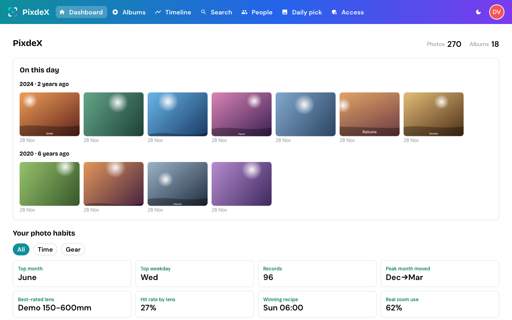
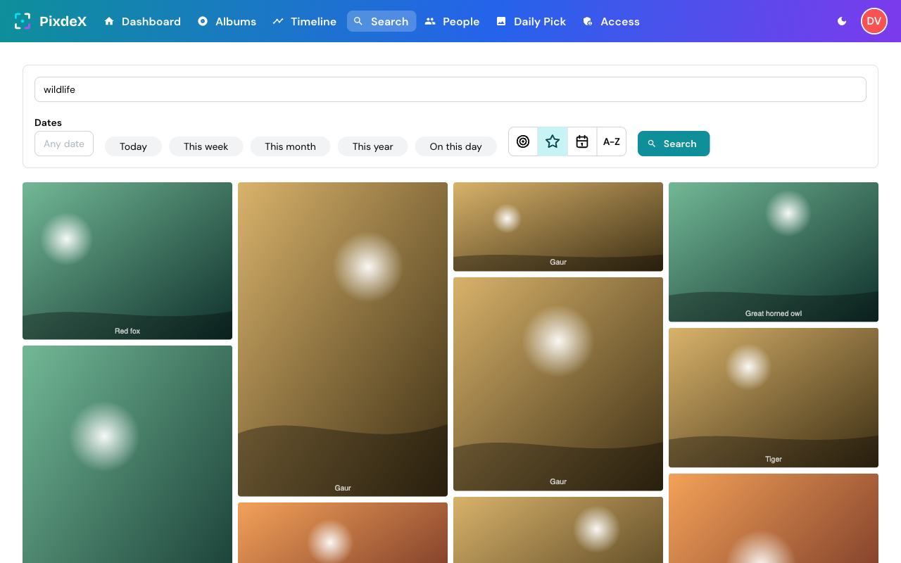
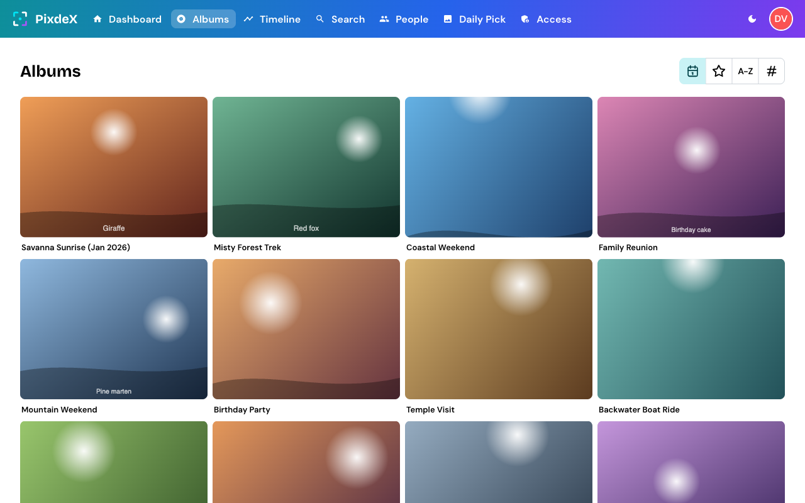
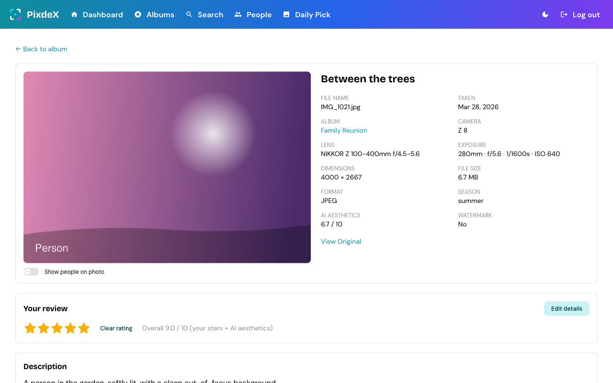
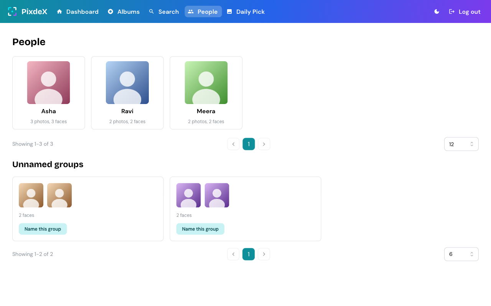
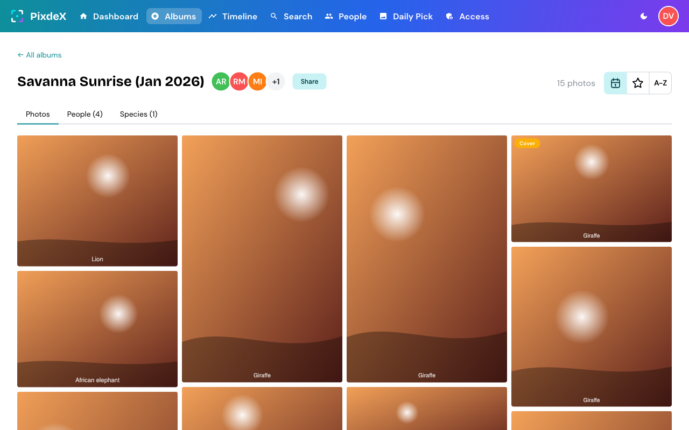
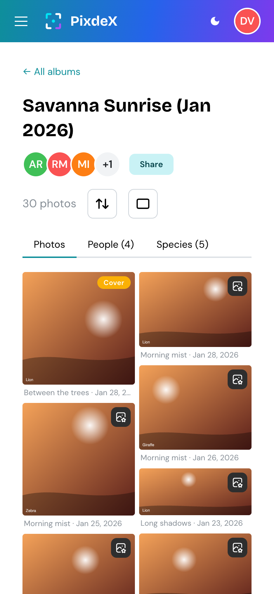

<h1 align="center">
  <picture>
    <source media="(prefers-color-scheme: dark)" srcset="docs/pixdex-logo.png">
    
  </picture>
</h1>

[](https://github.com/varunkumar/pixdex/commits/main)
[](https://github.com/varunkumar/pixdex/commits/main)

PixdeX indexes your photos with AI models on your computer. You can then search
them from a browser. The cloud stores only metadata and thumbnails. Original
files stay on your disk or in Google Drive.



*All screenshots use generated images and invented data.*

## Features

- **Search:** Use one box for text, albums, people, known personalities and dates.
  See [Search](docs/search.md).
- **Timeline:** See photos by date. Zoom between Day, Month and Year.
- **Albums:** Each album has Photos, People and Species tabs, and a cover banner.
- **Daily pick:** See one of your best nature or wildlife photos each day.
- **Review:** Give 1 to 5 stars. Correct the title, species and tags.
- **People:** Name face groups. PixdeX then finds more photos of each person.
- **Sharing:** Give other people read access to an album.
- **Details:** See camera data and GPS, and open the original file.

| Search | Albums |
|---|---|
|  |  |
| **Photo page** | **People** |
|  |  |
| **Album page** | **On a phone** |
|  |  |

## Architecture

```
photos ─► agent (Ollama + Python sidecars) ─► Worker (D1, R2) ◄─ Pages proxy ◄─ browser
```

| Part | Runs on | Function |
|---|---|---|
| `src/`, `functions/` | Cloudflare Pages | User interface and API proxy |
| `worker/` | Cloudflare Workers | API for ingest, search, albums and people |
| `agent/` | Your computer | Indexes photos, scans faces, serves originals |

The browser calls only `/api/*` on the same origin. The proxy adds the secret
token. For more data, see [Architecture](docs/architecture.md).

## Set up

### Prerequisites

- Node.js 18 or later
- A deployed `worker/` (see [Development guide](docs/development.md))
- For indexing: [Ollama](https://ollama.com)
- For the optional sidecars: Python 3.11 or 3.12

### Frontend

1. Install the dependencies: `npm install`.
2. Copy `.env.example` to `.env`.
3. Set `WORKER_URL` to the URL of your Worker.
4. Set `READ_TOKEN` to the value of the Worker secret `READ_TOKEN`.
5. Start the server: `npm run dev`.

To see the interface with invented data, use `PIXDEX_MOCK=1 npm run dev`. This
mode needs no secrets.

In production, set `WORKER_URL` and `READ_TOKEN` as Pages secrets. Do not add the
`VITE_` prefix to a secret.

## Index photos

Set up the agent (see [Index photos](docs/indexing.md)). Then run one of these
commands in `agent/`:

```bash
npm run dev -- index-local "/path/to/folder"   # one local folder
npm run dev -- index-drive                     # a Google Drive folder
npm run dev -- index-batch /Volumes/T9/Photos  # many albums, can resume
```

## Guides

| Guide | Contents |
|---|---|
| [Browse and review](docs/browsing.md) | Timeline, albums, grids, daily pick, ratings |
| [Search](docs/search.md) | Search box, filters, dates, AI Search |
| [Index photos](docs/indexing.md) | Agent setup, models, Drive, batch, move, sidecars |
| [People](docs/people.md) | Names, matching, review, ignore, known personalities |
| [Sharing and access](docs/sharing.md) | Album sharing, invite-only access, originals |
| [Architecture](docs/architecture.md) | Parts, data flow, configuration |
| [Development](docs/development.md) | Commands, deploys, rollout steps |
| [Manual data updates](docs/manual-updates.md) | Safe changes to live data |

## Develop and deploy

| Folder | Commands |
|---|---|
| root | `npm run dev`, `npm run build`, `npm test`, `npm run lint` |
| `worker/` | `npm test`, `npm run typecheck` |
| `agent/` | `npm test`, `npm run typecheck` |

A pre-commit hook runs the checks. A push to `main` deploys the frontend and the
Worker, and applies new database migrations. There is no test gate in the cloud,
so test before you push.

Rules for coding agents are in [`AGENTS.md`](AGENTS.md).

## Contribute

1. Fork the repository.
2. Make a feature branch.
3. Open a pull request.

## License

MIT. The InsightFace `buffalo_l` weights are for personal, non-commercial use
only.
